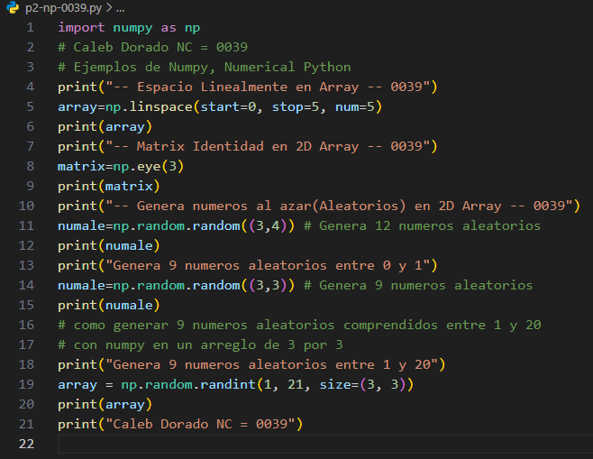
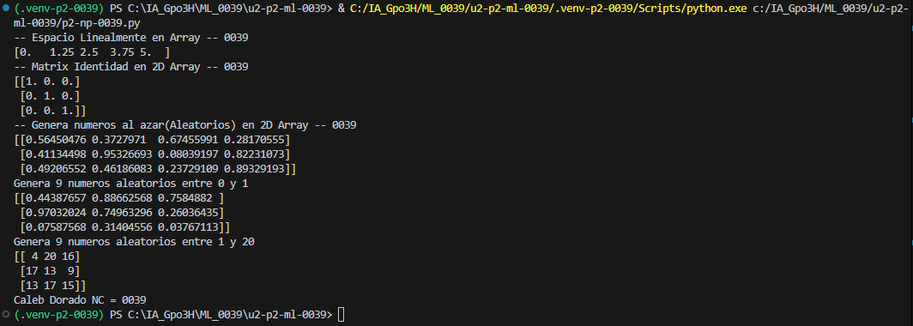

- `start=0`: Indica el valor inicial del intervalo.
- `stop=1`: Indica el valor final del intervalo.
- `num=5`: Indica la cantidad de números que se generarán.

## Que es np.linspace
- `linspace`: Es una función de NumPy que genera una cantidad específica de números distribuidos uniformemente entre un valor inicial y uno final.

## El codigo

## Resultado

